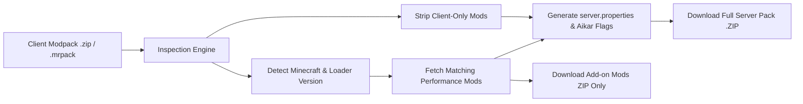

# 🚀 Minecraft Modpack to Server Converter

A self-hosted web application that transforms client modpacks (CurseForge `.zip`, Modrinth `.mrpack`, or custom archives) into ready-to-run, high-performance dedicated server packages.


---

## ✨ Features

- **Automated Client Mod Stripping**: Detects and purges 150+ known client-only mods (Sodium, Iris, JourneyMap, AppleSkin, SoundPhysics, Shaders, Minimaps, HUDs) as well as inspects `fabric.mod.json`, `quilt.mod.json`, and `META-INF/mods.toml` to prevent server crashes (`ClassNotFoundException` / `PhysicalSide`).
- **Server-Side Performance Injection**: Dynamically suggests and injects loader-specific, 100% vanilla-parity performance mods:
  - **Fabric / Quilt**: `Lithium`, `FerriteCore`, `Krypton`, `C2ME`, `ModernFix`, `Chunky`.
  - **Forge / NeoForge**: `FerriteCore`, `ModernFix`, `Canary`, `Chunky`.
- **Optional Admin / Utility Add-ons**: Add optional server-only tools (Ledger rollback, spark profiler, Chunky terrain pre-gen).
- **Dual Download Modes**:
  - **Full Server Bundle**: Output zip includes all mods, tuned `server.properties`, `eula.txt=true`, optimized startup scripts (`run.sh` / `run.bat` with Aikar's G1GC flags), and `Dockerfile` / `docker-compose.yml`.
  - **Add-on Mods Only**: Download a separate `.zip` containing just the server-side performance mods to drop into an existing server.
- **Proxmox VE 1-Liner Setup**: Automated helper script to spin up an isolated Debian 12 LXC container in seconds.

---

## ⚡ Quick Start: Proxmox VE 1-Liner

Run this command inside your **Proxmox Host Shell**:

```bash
bash -c "$(curl -fsSL https://raw.githubusercontent.com/IAndrexI/minecraftserver/main/install-proxmox-lxc.sh)"
```

The script will prompt you for your container ID, allocate resources, install dependencies, and launch the web dashboard at `http://<CONTAINER-IP>:8080`.

---

## 🐳 Docker / Docker Compose

```bash
# Clone the repository
git clone https://github.com/IAndrexI/minecraftserver.git
cd minecraftserver

# Start with Docker Compose
docker compose up -d
```
Access the web dashboard at `http://localhost:8080`.

---

## 💻 Manual Installation (Linux / Windows)

```bash
git clone https://github.com/IAndrexI/minecraftserver.git
cd minecraftserver

# Create virtual environment
python3 -m venv venv
source venv/bin/activate  # On Windows: venv\Scripts\activate

# Install requirements
pip install -r requirements.txt

# Run server
python app.py
```

---

## 🛠️ How It Works


